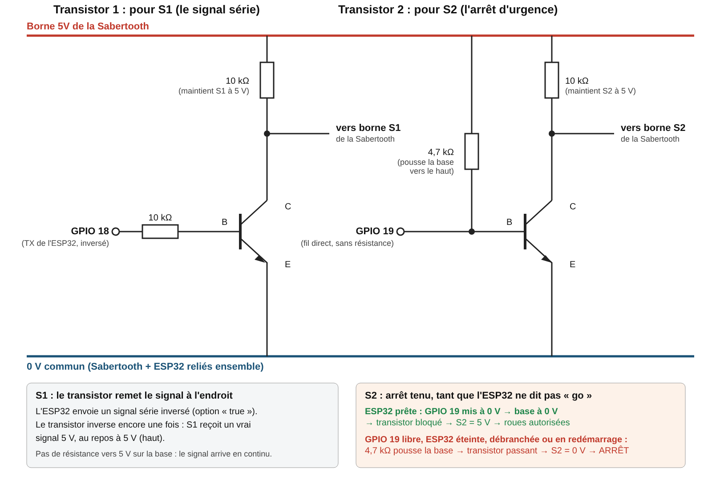
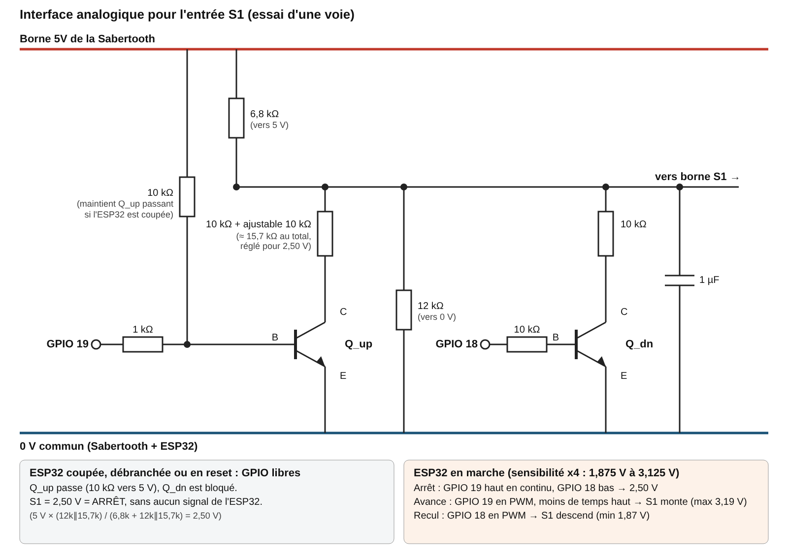

# Journal de bord du rover : 2026-11-07

> **Projet** : 243-6J7-LI (préparation 243-5J4-LI)  
> **Auteur** : Guillaume Retier  
> **Règle** : une entrée datée par séance. Aucun mot de passe ni jeton dans ce fichier.

**Sommaire** : [Résumé](#résumé) · [Lexique](#lexique) · [Ce qui a été fait](#ce-qui-a-été-fait) · [Problèmes rencontrés](#problèmes-rencontrés) · [Décisions](#décisions) · [À faire](#à-faire)

## Résumé

**En bref** : choix de la meilleure façon de commander les moteurs du robot depuis l'ESP32 (la carte de commande du robot), avec un arrêt de sécurité si quelque chose tombe en panne. Essais à la maison, roues en l'air, avec un multimètre seulement.

**Points clés**

- **Le mode « série à paquets » fonctionne** : l'ESP32 envoie les ordres à la Sabertooth sous forme de petits messages numériques, à deux vitesses de transmission (9600 et 38400 bauds). Seule, la Sabertooth ne s'arrête pas quand on débranche l'ESP32 : elle garde le dernier ordre reçu. **C'est le montage de sécurité sur S2 (ci-dessous) qui règle ce problème.**
- **L'entrée S2 sert de bouton d'arrêt d'urgence.** Tant qu'on la relie au 0 V, les roues sont arrêtées. Dès qu'on la relâche, les roues repartent avec le dernier ordre reçu : l'arrêt ne reste pas en place tout seul.
- **Un petit montage de sécurité sur S2** (un transistor commandé par l'ESP32) tient l'arrêt tant que l'ESP32 n'est pas prête. Si l'ESP32 est débranchée, redémarre ou se bloque (la minuterie de surveillance la redémarre alors), les roues s'arrêtent.
- **Ce que le montage ne couvre pas** : si le fil de S1 ou le fil de masse se détache pendant que le robot roule, les roues gardent le dernier ordre. La réponse retenue est mécanique : tout passe par le circuit imprimé et les fils vers la Sabertooth sont fixés (voir Décisions).
- **Il faut renvoyer le message d'initialisation (le nombre 170) avec chaque ordre.** Sinon, une Sabertooth rallumée après le début de l'envoi ne répond pas. Avec le renvoi, elle démarre dès l'allumage.
- **Le transistor placé sur S1 est nécessaire dans ce mode**, d'après les essais. Sans lui (S1 reliée directement à l'ESP32), la Sabertooth n'a plus obéi après un débranchement de l'ESP32, cinq fois de suite. Avec le transistor, aucun blocage n'a été observé.
- **Un nouveau programme peut être téléversé dans l'ESP32 sans éteindre la Sabertooth** (à vitesse de transmission inchangée).
- **Comparaison des modes de commande** : le Sabertooth peut être commandé de cinq façons (voir le lexique). Chaque mode est jugé avec les mêmes critères (`docs/comparatif-modes-commande.md`). Trois modes ont été essayés le 7 novembre. Un mode qui échoue à un critère de sécurité est écarté.
- **Radiocommande différentielle exponentielle : écartée.** Les roues s'arrêtent bien si l'ESP32 est coupée. Mais à l'essai 15, le Sabertooth a été coupé puis rallumé pendant que l'ESP32 envoyait « avance » : ensuite, l'ordre « arrêt » faisait avancer les roues et l'ordre « avance » les arrêtait. Explication : dans ce mode, le Sabertooth se recalibre à chaque remise sous tension : il prend pour position d'arrêt la largeur d'impulsion qu'il reçoit à ce moment-là (essais 7 à 10 du journal du 5 novembre). S'il s'allume pendant que l'ESP32 envoie « avance » (1600 µs), son arrêt devient 1600 µs. Le décalage dépend donc de l'étape du programme où se trouve l'ESP32 quand le Sabertooth s'allume. Un redémarrage de l'ESP32 seule ne le recalibre pas (essai 9 du 5 novembre).
- **Radiocommande microcontrôleur : écartée.** Si l'ESP32 est coupée, les roues continuent de tourner.
- **Analogique** : pas encore essayé (montage dessiné, non construit). **Série simplifiée** : reste à comparer avec les mêmes critères.

## Lexique

| Mot | Ce que c'est |
| --- | --- |
| ESP32 | La carte de commande : l'ordinateur du robot, qui envoie les ordres aux moteurs |
| Sabertooth | La carte qui fait tourner les moteurs d'après les ordres reçus |
| GPIO 18, GPIO 19 | Deux broches de l'ESP32 (des « sorties ») reliées aux transistors : GPIO 18 pour le signal de S1, GPIO 19 pour l'arrêt de sécurité de S2 |
| S1 et S2 | Les deux entrées de la Sabertooth par lesquelles elle reçoit les ordres |
| Mode de commande | La façon dont l'ESP32 parle à la Sabertooth : par impulsions (radiocommande), par une tension (analogique) ou par des messages numériques (série) |
| Impulsion, µs | Dans les modes radiocommande, l'ordre est la durée d'une impulsion, en microsecondes (µs). Environ 1500 µs = arrêt, moins = arrière, plus = avant |
| Transistor | Un interrupteur électronique : un petit courant sur une patte (la base) ouvre ou ferme le passage entre deux autres pattes |
| Résistance de rappel | Une résistance qui ramène un fil à une tension connue (par exemple 5 V) quand rien d'autre ne le pilote |
| Le nombre 170 | Un message d'initialisation que la Sabertooth attend avant les ordres en mode série : il lui indique la vitesse de transmission |
| Signe de vie | Un petit message envoyé toutes les 0,3 s par la page de pilotage au robot, pour lui dire que l'opérateur est toujours là et que toute la liaison fonctionne. Il traverse toute la chaîne (page, Internet, tunnel, serveur de messages, Wi-Fi) jusqu'à l'ESP32 : la liaison ESP32-serveur n'en est que le dernier tronçon. S'il n'arrive plus pendant 1 s, le robot s'arrête, quelle que soit la panne |
| Firmware | Le programme qui tourne dans l'ESP32 |
| PCB | Le circuit imprimé : la carte sur laquelle les composants sont soudés au lieu d'être reliés par des fils volants |
| Jumper | Un petit fil de liaison qu'on enfonce à la main, qui peut se détacher |
| MQTT | Le système de messages par lequel l'opérateur envoie ses ordres au robot par Internet |
| Minuterie de surveillance | Un mécanisme qui redémarre l'ESP32 si son programme se bloque |
| Arrêt de sécurité | Un montage qui arrête les roues sans l'aide du logiciel, par exemple si l'ESP32 est coupée |
| 0 V, masse | Le point de référence de toutes les tensions, relié entre la Sabertooth et l'ESP32 |

## Ce qui a été fait

### Matériel

- ESP32 (LilyGO T-A7670E), Sabertooth Dual 5A Reg, 4 moteurs du châssis A4WD1, pile 3S avec fusible de 3 A, multimètre.
- Deux transistors 2N3904, résistances de 10 kΩ (2), 4,7 kΩ (1) et 330 Ω (essai en direct).

### Montage retenu

1. Masse de l'ESP32 reliée au 0V du Sabertooth.
2. **S1** : GPIO 18 → 10 kΩ → base du premier 2N3904 ; collecteur → S1 et 10 kΩ → borne 5V ; émetteur → 0V. Liaison série inversée côté ESP32 (`Serial1.begin(9600, SERIAL_8N1, -1, 18, true)`) : le transistor inverse à nouveau le signal.
3. **S2** (arrêt de sécurité) : deuxième 2N3904, émetteur → 0V, collecteur → S2 et 10 kΩ → borne 5V ; base → 4,7 kΩ → borne 5V, et GPIO 19 reliée directement à la base. GPIO 19 en sortie à 0 V : roues débloquées. GPIO 19 libre (entrée), ESP32 éteinte ou en réinitialisation : S2 à 0 V, arrêt.
4. Interrupteurs du Sabertooth (mode paquets, adresse 128) : B B H H H H, 3 en bas (coupure pour pile lithium).

### Comment fonctionnent les deux transistors (S1 et S2)

Un transistor se comporte ici comme un interrupteur relié au 0 V. Un petit courant dans sa base le ferme (il tire alors la sortie vers 0 V) ; sans courant, il reste ouvert.

**Transistor de S1 : il porte les messages vers la Sabertooth.**

- L'ESP32 sort ses signaux à 3,3 V. La notice de la Sabertooth parle d'un signal « de niveau TTL » (5 V) sans donner de seuil précis.
- Les essais ont montré que le transistor est nécessaire : sans lui, après un débranchement de l'ESP32, la Sabertooth ne répondait plus aux ordres (essai 10). La cause exacte n'est pas établie.
- Quand GPIO 18 est à l'état haut, le transistor se ferme et tire S1 vers 0 V. Quand GPIO 18 est à l'état bas, il s'ouvre et la résistance de 10 kΩ, reliée au 5 V, remonte S1 à 5 V.
- Le signal est donc relevé à 5 V, mais aussi inversé. C'est pourquoi le programme envoie un signal déjà inversé (`true` dans `Serial1.begin`) : le transistor le remet à l'endroit.

**Transistor de S2 : il tient l'arrêt de sécurité.**

**Pourquoi ce montage.** Si l'ESP32 tombe en panne ou est débranchée pendant que le robot roule, la Sabertooth garde le dernier ordre reçu et les roues continuent de tourner (essai 3). L'ESP32 ne peut pas arrêter les roues puisqu'elle n'est plus là. On a donc fait en sorte que l'arrêt soit la situation normale du montage : il est tenu par le transistor de S2, sans aucun programme. L'ESP32 doit lever cet arrêt pour que les roues puissent tourner. Sans elle, l'arrêt revient.

| Situation | GPIO 19 | Transistor | S2 | Roues |
| --- | --- | --- | --- | --- |
| ESP32 coupée, débranchée ou en redémarrage | libre (ne fait rien) | passant : la résistance de 4,7 kΩ pousse sa base vers 5 V | 0 V | arrêt |
| ESP32 en marche et prête | mis à 0 V par le programme | bloqué : sa base est ramenée à 0 V | 5 V (résistance de 10 kΩ) | débloquées |
| Programme figé, redémarré par la minuterie de surveillance | redevient libre | passant | 0 V | arrêt |

**En résumé :** le montage de sécurité arrête les roues par défaut (il tient l'entrée S2 de la Sabertooth à 0 V). Ce n'est pas l'ESP32 qui les arrête : elle doit au contraire les débloquer, en mettant GPIO 19 à 0 V, pour qu'elles puissent tourner. Si elle disparaît, le montage arrête de nouveau les roues tout seul.

### Choix des valeurs des résistances

Le transistor sert d'interrupteur : il doit être **bien fermé** quand on le commande (on dit « saturé ») et **bien ouvert** sinon. Les valeurs sont courantes et ont été vérifiées par un calcul, puis par les mesures. Elles n'ont pas été optimisées davantage.

| Résistance | Valeur | À quoi elle sert | Pourquoi cette valeur |
| --- | --- | --- | --- |
| Entre GPIO 18 et la base du transistor de S1 | 10 kΩ | Limiter le courant que l'ESP32 envoie dans le transistor | Courant : (3,3 V − 0,65 V) / 10 kΩ = 0,27 mA. C'est peu pour la broche de l'ESP32, et c'est largement assez : le transistor doit laisser passer 0,5 mA, et un 2N3904 en demande une centaine de fois moins à sa base (gain d'au moins 100 d'après la fiche habituelle du composant, non revérifiée ici). Beaucoup plus grande (1 MΩ) : 2,6 µA, trop peu pour bien fermer le transistor. Beaucoup plus petite (100 Ω) : la broche fournirait 26 mA pour rien |
| De S1 vers le 5 V | 10 kΩ | Remonter S1 à 5 V quand le transistor est ouvert | S1 seule, sans rien de branché, lit 0 V (−3 mV) : l'entrée n'a pas de résistance interne vers le haut. Courant quand le transistor est fermé : 4,98 V / 10 kΩ = 0,5 mA. La borne 5 V du Sabertooth ne doit pas fournir plus de 10 mA (notice) : avec les trois résistances de ce montage, le total reste d'environ 2 mA. Avec 1 kΩ, ce serait 5 mA par résistance ; avec 100 kΩ, le signal monterait trop lentement |
| De S2 vers le 5 V | 10 kΩ | Remonter S2 à 5 V quand le transistor est ouvert (roues débloquées) | Mêmes raisons que pour S1 |
| De la base du transistor de S2 vers le 5 V | 4,7 kΩ | Fermer le transistor (donc arrêter les roues) dès que GPIO 19 est libre | ESP32 coupée : courant dans la base = (5 V − 0,65 V) / 4,7 kΩ = 0,9 mA, soit près de 200 fois ce qu'il faut pour bien fermer le transistor (0,5 mA / 100 = 5 µA) : l'arrêt reste certain même si le composant est moins bon ou chaud. ESP32 prête : GPIO 19 absorbe ces 0,9 mA, ce qui est peu pour la broche, et tient la base à 32 mV (mesuré), très loin des 0,6 V qui fermeraient le transistor. Beaucoup plus grande (100 kΩ) : le courant de fuite ou un parasite pourraient suffire à faire fermer ou rouvrir le transistor. Beaucoup plus petite (470 Ω) : la broche absorberait 9 mA en permanence |

**Courant total pris sur la borne 5 V** : 0,5 mA (S1) + 0,5 mA (S2) + 0,9 mA (rappel de la base de S2, seulement quand l'ESP32 est prête) = environ 2 mA, bien sous la limite de 10 mA.

### Essais

Chaque essai est présenté avec son but, ses conditions, son résultat et ce qu'on en conclut.

| N° | But | Conditions de test | Résultats | Conclusion |
| --- | --- | --- | --- | --- |
| 1 | Voir si le mode le plus simple (un seul nombre par ordre) convient | Série simplifiée ; interrupteurs H B H B B H ; 38400 bauds ; transistor sur S1 | Les valeurs 1 à 127 commandent le moteur 1 (64 = arrêt), 128 à 255 le moteur 2 (192 = arrêt), 0 arrête les deux. Chaque moteur garde sa dernière commande ; aucun délai d'attente observé | Le mode fonctionne. Sa comparaison avec les critères reste à compléter |
| 2 | Tester le mode à messages complets, plus riche, et voir à quelles vitesses de transmission il fonctionne | Mode paquets ; moteur 1 (commandes 0 et 1) ; 38400 et 9600 bauds ; 170 envoyé avant | Le moteur 1 avance et recule aux deux vitesses | Le mode paquets fonctionne à 38400 et à 9600 bauds |
| 3 | Voir ce qui arrive aux roues quand l'ESP32 est débranchée, sans montage de sécurité | Mode paquets ; S2 en rappel seul ; ESP32 débranchée pendant « M1 avance » | La roue continue d'avancer | Sans montage de sécurité, la Sabertooth garde la dernière commande : il faut un arrêt de sécurité |
| 4 | Vérifier que l'entrée S2 arrête les roues quand on la relie à 0 V | S2 reliée à 0 V pendant que la roue tourne | Les roues s'arrêtent ; le fil retiré, elles reprennent la dernière commande | S2 peut servir d'entrée d'arrêt de sécurité, mais elle ne verrouille pas l'arrêt une fois relâchée |
| 5 | Vérifier que le montage de sécurité arrête les roues quand l'ESP32 est débranchée ou redémarre | Montage de sécurité sur S2 ; « M1 avance » ; S2 (collecteur) 4,98 V, base 32 mV ; ESP32 débranchée ; deux façons de relâcher S2 au démarrage | ESP32 débranchée : les roues s'arrêtent. Si S2 est relâchée avant les ordres d'arrêt, les roues reprennent la dernière commande pendant le démarrage. Avec les ordres d'arrêt envoyés avant le relâchement de S2, elles restent immobiles pendant tout le redémarrage | Le montage arrête les roues. Au démarrage, il faut envoyer les ordres d'arrêt avant de relâcher S2 |
| 6 | Vérifier qu'on peut changer le programme de l'ESP32 sans éteindre la Sabertooth (nécessaire pour une mise à jour à distance) | Nouveau programme téléversé sans couper la Sabertooth (vitesse de l'avance changée), puis une séquence différente (moteurs 1 et 2) | La nouvelle vitesse est prise en compte ; même résultat avec la séquence | Une mise à jour du programme se fait sans couper la Sabertooth |
| 7 | Vérifier que la minuterie redémarre l'ESP32 quand son programme se bloque, et que les roues s'arrêtent | Minuterie de surveillance de 2 s ; programme volontairement bloqué | Le moniteur affiche le déclenchement 1,9 s après le blocage ; les roues s'arrêtent 1 à 2 s après le blocage | Le cas du programme figé est couvert |
| 8 | Comprendre pourquoi une Sabertooth rallumée en cours de route ne répondait pas toujours | 170 envoyé seulement pendant les 20 s de démarrage, puis 170 renvoyé avec chaque paquet ; démarrage court (sans les 20 s) avec 5 mises sous tension à des moments différents | 170 seulement au démarrage : une Sabertooth rallumée après ces 20 s ne bouge pas. 170 renvoyé avec chaque paquet : elle démarre tout de suite. Les 5 mises sous tension ont réussi | Il faut renvoyer le 170 avec chaque paquet |
| 9 | Trouver combien de temps il faut couper la Sabertooth pour la remettre à zéro | Coupures de durées différentes | Environ 3 s ne suffit pas ; environ 5 s suffit | Couper la Sabertooth au moins 5 s |
| 10 | Vérifier si le transistor sur S1 est vraiment nécessaire | S1 en direct (GPIO 18 → 330 Ω → S1, sans transistor, liaison non inversée) ; ESP32 débranchée environ 10 s puis rebranchée, Sabertooth restée allumée ; 5 répétitions sans couper la Sabertooth entre deux | 3,1 V mesurés à S1 ; la Sabertooth obéit après une coupure complète. Après débranchement et rebranchement, les roues ne repartent pas (5 fois sur 5) ; S1 à environ 0 V quand l'ESP32 est débranchée. Avec le transistor, aucun blocage de ce type lors des débranchements, des téléversements et des redémarrages par la minuterie | Le transistor sur S1 est conservé. La cause du blocage en direct n'est pas établie |
| 11 | Voir l'effet d'un fil détaché pendant la marche | ESP32 en marche, montage à transistor ; fils retirés un par un pendant la marche avant | Fil de S1 retiré : les roues continuent d'avancer. Fil de masse retiré : la dernière commande est maintenue. Fil de S2 retiré : les roues s'immobilisent | S2 est protégée ; S1 et la masse ne le sont pas. D'où la décision de tout passer par le circuit imprimé et de fixer les fils (voir Décisions) |
| 12 | Contrôler les tensions du montage de sécurité | Mesures au multimètre | S2 avec 10 kΩ vers 5V : 4,97 V ; S1 (collecteur) 4,81 V, base 106 à 120 mV | Valeurs relevées pour référence |
| 13 | Essayer le mode radiocommande avec les deux entrées S1 et S2 pilotées | Radiocommande différentielle exponentielle ; interrupteurs B H B H B H ; S1 et S2 reçoivent chacune des impulsions de 1000 à 2000 µs | S1 fait avancer ou reculer les quatre roues, S2 les fait tourner sur place. À 1500 µs, les roues sont complètement immobiles | Le mode fonctionne à condition que 1500 µs soit le premier ordre envoyé quand on allume la Sabertooth |
| 14 | Voir si les roues s'arrêtent quand l'ESP32 est coupée ou bloquée | Même mode ; ESP32 coupée ; programme bloqué (minuterie de 2 s) | Les roues s'arrêtent tout de suite à la coupure de l'ESP32, et environ 3 s après le blocage du programme. Après une panne de l'ESP32 seule, les ordres reprennent d'eux-mêmes | Dans ce mode, l'arrêt sur coupure ou blocage de l'ESP32 fonctionne |
| 15 | Voir ce qui se passe quand la Sabertooth est allumée pendant que l'ESP32 envoie « avance » (pour simuler une micro-coupure de sa pile) | Même mode ; Sabertooth coupée au moins 5 s puis rallumée pendant que l'ESP32, restée en marche, envoie « S1 avant » (1600 µs). Un premier essai, mélangé à un blocage volontaire du programme, n'était pas exploitable | Quand le programme revient à « Arrêt » (1500 µs), les roues continuent d'avancer ; quand il envoie « S1 avant » (1600 µs), elles s'arrêtent | L'arrêt de la Sabertooth s'est déplacé à 1600 µs, la largeur d'impulsion reçue à son allumage : l'ordre d'arrêt ne l'arrête plus. Mode écarté |
| 16 | Voir l'effet d'un fil détaché ou touché, et de la mise à jour du programme | Même mode ; S1 à 1600 µs ; fils retirés pendant la marche ; fil débranché approché d'une autre borne ; doigt posé sur les fils branchés ; nouveau programme téléversé sans toucher à l'alimentation de la Sabertooth | Fil de S1 retiré : les roues du côté 1 s'arrêtent, celles du côté 2 continuent. Fil de S2 retiré : les roues du côté 2 s'arrêtent, celles du côté 1 accélèrent et ralentissent sans ordre. Fil de masse ou de 5 V retiré : tout s'arrête et repart quand on le remet. Fil débranché approché d'une autre borne : les roues bougent de façon irrégulière. Doigt sur les fils branchés : aucune réaction. Nouveau programme : pris en compte | Les fils détachés perturbent les roues. La mise à jour fonctionne tant qu'on ne touche pas à l'alimentation de la Sabertooth (conclusion de Guillaume) |
| 17 | Mesurer la finesse du réglage de la vitesse | Même mode ; largeurs d'impulsion balayées en avant et en arrière | Première série : démarrage vers 1555 µs (avant) et 1445 µs (arrière), puis vers 1600 µs aux séries suivantes. Vitesse maximale à 1950 µs (avant) et 1000 µs (arrière). Quinze vitesses différentes perceptibles à l'avant | Le réglage est assez fin (plus de 10 vitesses), mais la zone où les roues ne bougent pas se déplace d'une série à l'autre |
| 18 | Essayer le mode où la Sabertooth ne s'adapte pas toute seule (centre fixe à 1500 µs) et voir s'il s'arrête quand l'ESP32 est coupée | Radiocommande microcontrôleur ; interrupteurs B H B B H B ; ESP32 débranchée (câble USB retiré) pendant la marche | À 1500 µs les roues tournent un peu ; elles sont immobiles de 1470 à 1490 µs. Le côté 1 avance dès 1490 µs et le côté 2 dès 1495 µs ; les deux reculent dès 1430 µs. Vitesse maximale à 1930 µs (avant) et 1005 µs (arrière), environ 18 vitesses de chaque côté. ESP32 débranchée : les roues continuent de tourner. Au rebranchement, elles s'arrêtent environ 1 s puis reprennent d'elles-mêmes | Mode écarté : pas d'arrêt si l'ESP32 est coupée. Le point d'arrêt réel est vers 1480 µs, pas 1500 µs (à mesurer à l'oscilloscope) |
| 19 | Prévoir un montage qui arrête les roues si l'ESP32 est coupée, dans le mode analogique | Analogique ; non essayé ; montage dessiné où S1 est tenue à 2,50 V, la valeur d'arrêt de ce mode | Montage non construit | À construire et à essayer (voir À faire, C8) |

### Programmes

Enregistrés dans `C:\Arduino` : `test_09_sabertooth_serie_simplifie`, `test_10_sabertooth_paquets`, `test_11_sabertooth_paquets_s2_watchdog`, `test_12_sabertooth_demarrage_court`, `test_13_sabertooth_rc_microcontroleur`, `test_14_sabertooth_micro_tenue` et `test_15_sabertooth_analogique` (jamais essayé). Les programmes des essais 13 à 17 (radiocommande différentielle et balayages) n'ont pas été enregistrés ; `test_13` permet de refaire des essais équivalents en réglant le centre à 1500 µs.

## Comparatif des modes de commande

Les cinq modes de la fiche du Sabertooth. Les critères, les résultats et le détail des échecs sont dans `docs/comparatif-modes-commande.md`. Interrupteurs : H = haut, B = bas, positions 1 à 6 (3 en bas pour la pile lithium dans tous les modes).

| Mode | Interrupteurs | Si l'ESP32 est coupée, les roues... | Si la Sabertooth est éteinte puis rallumée pendant que l'ESP32 envoie « avance »... | Résultat |
| --- | --- | --- | --- | --- |
| Analogique | H H H B H H | non testé | non testé | Pas essayé (montage dessiné) |
| Radiocommande différentielle exponentielle | B H B H B H | s'arrêtent tout de suite | l'ordre d'arrêt (1500 µs) les fait avancer (essai 15) | **Écarté**, à cause de l'essai 15 |
| Radiocommande microcontrôleur | B H B B H B | continuent | non testé (mode déjà écarté) | **Écarté**, à cause de l'ESP32 coupée |
| Série simplifiée | H B H B B H | continuent | non testé | Essayé, comparaison à compléter |
| **Série à paquets** | B B H H H H | continuent, sauf avec l'arrêt de sécurité sur S2 | pas de mouvement non commandé ; elle repart si le 170 est renvoyé | Provisoire |

Une combinaison « radiocommande indépendante » (B H B B H H) a aussi été essayée les 5 et 7 novembre. Elle ne figure pas sur la fiche du Sabertooth et n'est plus comparée.

## Problèmes rencontrés

| # | Problème | Cause | Correctif |
| --- | --- | --- | --- |
| 1 | Aucun mouvement en mode paquets à 9600 (premiers essais) | Non établie ; essais faits sans coupure complète du Sabertooth | Couper le Sabertooth au moins 5 s entre deux essais ; fonctionne ensuite à 9600 et à 38400 |
| 2 | Les roues reprennent la dernière commande quand l'ESP32 redémarre | S2 relâché avant les ordres d'arrêt | Ordres d'arrêt envoyés pendant que S2 est en arrêt, puis relâchement |
| 3 | Sabertooth rallumé après la fenêtre du 170 : aucune réponse | Aucun 170 reçu après son allumage | 170 renvoyé avec chaque paquet |
| 4 | Coupure d'environ 3 s sans effet | Pas de réinitialisation du Sabertooth à cette durée | Couper au moins 5 s |
| 5 | S1 en direct : plus d'obéissance après un débranchement de l'ESP32 | Non établie | Transistor sur S1 conservé |
| 6 | Premier essai en direct non valable | Programme encore avec liaison inversée ; 330 Ω reliée au 5V au lieu de S1 | Câblage et programme corrigés, essai refait |
| 7 | Après un redémarrage du Sabertooth en plein mouvement, l'ordre d'arrêt fait avancer les roues et l'ordre d'avance les arrête (radiocommande différentielle exponentielle) | Le Sabertooth se recalibre à chaque allumage : il a pris pour centre les 1600 µs reçus à ce moment-là (cohérent avec les essais 7 à 10 du 5 novembre) | Mode écarté |
| 8 | Les roues gardent la dernière commande quand l'ESP32 est coupée (radiocommande microcontrôleur) | Ce mode n'a pas de minuterie d'arrêt (documentation du Sabertooth, interrupteur 6 en bas) | Mode écarté |
| 9 | Centre de la radiocommande microcontrôleur vers 1480 µs au lieu de 1500 µs | Non établie ; les impulsions sont peut-être décalées par le montage à transistor | Mesure à l'oscilloscope (tâche C3) ; valeur d'arrêt à calibrer dans le firmware |

## Décisions

| Sujet | Décision | Pourquoi | Statut |
| --- | --- | --- | --- |
| Mode de commande | Série à paquets, adresse 128, 9600 bauds, 170 renvoyé avec chaque paquet | Seul mode essayé jusqu'ici qui, avec le montage de sécurité sur S2, arrête les roues si l'ESP32 est coupée ou bloquée et ne bouge pas au démarrage (voir le comparatif) | Provisoire : il reste à comparer l'analogique et la série simplifiée (C8) |
| Arrêt de sécurité | Transistor sur S2 commandé par GPIO 19 ; ordres d'arrêt avant le relâchement de S2 au démarrage | La Sabertooth seule garde le dernier ordre si l'ESP32 disparaît (essai 3). Les ordres d'arrêt envoyés avant de débloquer évitent que les roues repartent pendant le redémarrage (essai 5) | Retenue (7 novembre) |
| Transistor sur S1 | Conservé : nécessaire dans ce mode d'après les essais (S1 en direct non fiable). Autres modes non testés | Sans lui, la Sabertooth ne répondait plus après un débranchement de l'ESP32 (essai 10) ; avec lui, aucun blocage | Retenue (7 novembre) ; essai en direct : 5 rebranchements successifs sans reprise, Sabertooth jamais coupée entre deux |
| Règle de comparaison | Un mode qui échoue à un critère de sécurité est écarté ; ses autres critères ne sont plus testés | Un mode qui n'est pas sûr ne sera pas retenu quelles que soient ses performances : inutile de passer du temps sur ses autres critères | Retenue (7 novembre) |
| Programme figé | Minuterie de surveillance de 2 s conservée | Un programme bloqué laisse les roues sur le dernier ordre ; la minuterie redémarre l'ESP32, et le montage de sécurité arrête alors les roues (essai 7) | Retenue (7 novembre) |
| Pannes de câblage (fil de S1 ou de masse détaché) | Aucune détection électronique possible avec ce mode. Tout passe par le PCB ; seuls les fils entre le Sabertooth et le PCB restent des jumpers, fixés (bornes verrouillées ou soudures, serre-câble) | Un fil de S1 ou de masse détaché fait garder le dernier ordre (essai 11) et aucun montage simple ne le détecte : on l'empêche donc mécaniquement | Retenue (7 novembre) |

## À faire

| Réf. | Tâche |
| --- | --- |
| C1 | Firmware : n'envoyer une vitesse aux moteurs que si un message de l'opérateur (un ordre ou un signe de vie) est arrivé il y a moins de 1 s ; sinon, arrêt. Le signe de vie est un petit message « 1 » envoyé toutes les 0,3 s par la page de pilotage ouverte, par MQTT. Il part du poste de l'opérateur et traverse toute la chaîne jusqu'à l'ESP32 (page, Internet, tunnel, serveur de messages, Wi-Fi) : on vérifie donc que l'opérateur est toujours là, pas seulement que l'ESP32 est connecté au serveur. Si un maillon casse (page fermée, ordinateur planté, Internet ou Wi-Fi coupé, serveur arrêté), le signe de vie n'arrive plus et le robot s'arrête au bout de 1 s. Cette durée est indicative : elle vient du cahier des charges, mais la chaîne est longue (tunnel, puis 4G) et 1 s est peut-être trop court, car un simple retard passager arrêterait le robot sans vraie panne. À valider en mesurant les délais réels d'arrivée des signes de vie (Wi-Fi puis 4G), et à confirmer avec Tristan |
| C2 | Rampes d'accélération et de décélération (fusible de 3 A) ; le courant doit rester sous 3 A à l'accélération |
| C3 | Oscilloscope (cégep) : signal sur S1, comportement de GPIO 18 et de S2 à la mise sous tension ; largeur réelle des impulsions sur S1 et S2 (arrêt trouvé à 1480 µs au lieu de 1500 µs en radiocommande microcontrôleur) |
| C4 | Essais au sol, avec la charge du robot |
| C5 | Moyen de remettre le Sabertooth en état sans intervention (coupure de son alimentation commandée par l'ESP32, régénération à vérifier) |
| C7 | Panne de liaison : concevoir les fils Sabertooth-PCB (S1, S2, 5V, 0V) avec bornes verrouillées, serre-câble, deux fils de masse ; fils de S1 et de masse non protégés électroniquement (fixation mécanique des bornes, coupure indépendante de l'alimentation du Sabertooth) ; tester chaque fil par traction |
| C8 | Comparer l'analogique (montage à construire, voir le schéma) et la série simplifiée avec les mêmes critères que les trois modes déjà jugés, puis choisir et justifier le mode |
| C6 | Mettre à jour le dossier (conception préliminaire, preuve de concept) |
